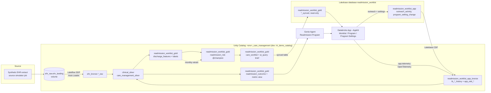

# Readmission Prevention Worklist

A reference solution on Databricks that helps a hospital care management team cut avoidable 30-day readmissions. Every morning it scores yesterday's discharges for readmission risk, routes high-risk patients to the right care manager with a plain-language outreach brief, captures each outreach call, and measures whether the program is actually moving readmission rates.

> **Status:** Phase 5 of 7 complete (bundle, synthetic EHR source simulator, Lakeflow SDP pipeline, readmission model with champion/challenger gates, daily scoring and capacity-capped worklist with `ai_query` briefs, program history from 2026-05-01, Lakebase synced worklist and CDF write-back, simulated outreach history, AppKit app with Worklist / Program / Program Settings tabs, Program Settings applied by the pipeline, `readmission_outcome`, app telemetry and audit events). Genie, the metric view, and ABAC policies are Phase 6. The high-level design is in [`docs/`](docs/). Sections marked *(planned)* describe the target state.
>
> All data is **synthetic**. No real patient or customer data is used anywhere in this repository.

## Business problem

Hospitals pay twice for avoidable readmissions: the cost of the return stay, and CMS Hospital Readmissions Reduction Program (HRRP) penalties on Medicare base payments. Care management teams know that a timely post-discharge call and a 7-day follow-up appointment reduce readmissions, but they cannot call everyone. They need a short, prioritized, explainable list every morning, and leadership needs to see whether the outreach is working.

| Stakeholder | What they get |
|---|---|
| VP of Care Management (executive sponsor) | Readmission rate, reach rate, 7-day follow-up rate, and estimated cost avoided, by facility and risk tier |
| Care Manager (daily user) | A prioritized worklist with the top risk drivers and an AI-drafted outreach brief per patient; one click to log the call |
| Data Platform / Architecture | One Declarative Automation Bundle, governed PHI, environment-local deployment, no hand-built infrastructure |

## Architecture

The solution is a single integrated loop. Each layer feeds the next, and outreach results flow back into the lakehouse to measure outcomes and retrain the model.



### Operating steps

| # | Step | Who / what | Key assets |
|---|---|---|---|
| 1 | Configure program | Care Management Leadership, in the app's Program Settings tab | Lakebase `readmission_worklist_app.program_setting_change`; seed files for the initial load |
| 2 | Ingest + curate | `<env>_readmit_daily_cycle` > `ingest_curate` (Lakeflow Spark Declarative Pipeline) | `ehr_raw.ehr_landing` to `ehr_bronze` to `clinical_silver` / `care_management_silver` to `readmission_worklist_gold.discharge_features` |
| 3 | Score + prioritize | `score_discharges` task | `readmission_worklist_gold.readmission_risk@champion`, `discharge_risk_score` |
| 4 | Build + publish worklist | `build_worklist` task | `ai_query` outreach brief, `readmission_worklist_gold.care_worklist`, Lakebase synced tables |
| 5 | Work the worklist | Care Manager, in the app's Worklist tab | Lakebase `readmission_worklist_gold.care_worklist_synced` (read), `readmission_worklist_app.outreach_activity` (insert) |
| 6 | Sync changes back | Lakebase CDF (change data feed) + Databricks Apps telemetry | `readmission_worklist_app_bronze.lb_*_history`, `app_otel_logs` / `_traces` / `_metrics` |
| 7 | Measure + ask Genie | Leadership / Quality, in the app's Program tab | Genie Agent over `readmission_worklist_gold.readmission_outcome` and `readmission_program_metrics` |
| 8 | Retrain + repeat | `<env>_readmit_model_training` (monthly) | MLflow experiment, `@challenger` promoted to `@champion` only if it beats the current model |

Design decisions are logged in [`docs/DECISIONS.md`](docs/DECISIONS.md). The full operating pattern, deployment pattern, and entity-relationship diagram are in [`docs/readmission-worklist-high-level-design.pdf`](docs/readmission-worklist-high-level-design.pdf).

### Naming convention

| Layer | Pattern | This solution |
|---|---|---|
| Raw (files) | `<source_system>_raw` | `ehr_raw` (volume `ehr_landing`) |
| Bronze | `<source_system>_bronze` | `ehr_bronze`; `readmission_worklist_app_bronze` (the app is a source system; Lakebase CDF and app telemetry land here) |
| Silver | `<data_domain>_silver` | `clinical_silver`, `care_management_silver` |
| Gold | `<data_product>_gold` | `readmission_worklist_gold` (tables, metric view, and the model) |
| Shared governance | `phi_governance` | Mask and row filter functions used by every product |
| Internal (not a data product) | `<data_product>_sync_internal` | `readmission_worklist_sync_internal` (Lakebase synced-table pipeline storage; no analyst grants, not in Genie) |
| Lakebase | project and database named after the app | project `readmission-worklist`, database `readmission_worklist` |
| Lakebase schemas | mirror UC at the schema level | `readmission_worklist_gold` (synced tables, `_synced` suffix); `readmission_worklist_app` (app-owned writes) |

Names line up at the **schema** level because that is where Lakebase maps them: a synced table's UC schema becomes its Postgres schema, and Lakebase CDF maps one Postgres schema to one UC schema. One database per app keeps the synced worklist and the app's writes joinable in Postgres. Lakebase resource IDs allow hyphens only, while Postgres and UC names use underscores.

### Governance

- Every PHI column carries a governed tag `phi = direct_identifier | quasi_identifier`.
- Tag-driven ABAC policies on the silver and gold schemas mask direct identifiers and filter rows by facility for every SQL, notebook, and Genie read.
- The `readmission_worklist_app_bronze` schema (Lakebase CDF destination) is excluded from masks and filters because CDF destinations must not carry them; access is restricted to the pipeline identity instead.
- Unity Catalog row filters do not apply inside Lakebase Postgres, so the app scopes every query to the signed-in user's facility assignments. Only the minimum columns a care manager needs are synced to Lakebase.
- The Program Settings tab is limited to the `care_mgmt_leadership` group; every change is an append-only row with who, when, and why.
- **Access audit:** the app emits `audit.*` events (`worklist.viewed`, `outreach.logged`, `settings.changed`, `genie.asked`) through Databricks Apps telemetry (OpenTelemetry, GA) into `app_otel_logs`; the pipeline de-duplicates them on `event_id` into `care_management_silver.app_audit_event`. Telemetry carries IDs only, never PHI.
- **Dev-only deviation:** `rtr_demo_catalog` grants `account users` SELECT catalog-wide, which inherits into the unmasked CDF landing schema. Accepted for dev because all data is synthetic; prod uses a dedicated catalog with no account-wide grants.

### Key design decisions and trade-offs

| Decision | Why | Trade-off |
|---|---|---|
| One daily job with ordered tasks | One schedule to run and explain | Less independent scheduling per stage |
| Batch scoring, no serving endpoint | Discharges are scored once a day | Not real-time at discharge |
| Worklist status derived from `outreach_activity` | Synced tables are read-only in Postgres | One join in the app query |
| Lakebase CDF for write-back | Native, about 15 s latency, no job to maintain | Public Preview; source tables need `REPLICA IDENTITY FULL` |
| Program Settings tab writes to Lakebase, applied by the pipeline | Leadership owns thresholds and capacity, with an audit trail, reusing the CDF pattern | Changes take effect on the next daily cycle |
| Databricks Apps telemetry for audit events | Native OpenTelemetry export to UC, configured in the bundle; no custom write path | Business events still need a small emit helper in the app |
| AppKit (Node/TypeScript/React) for the app | Databricks default and template-aligned | Team must be comfortable with TypeScript |
| Separate Lakebase schemas, one database | Postgres cannot join across databases; the app joins the synced worklist with its own writes | Schema-level ownership must be managed carefully |
| XGBoost on LACE-style features | Clinicians recognize the drivers; explainable with SHAP | Not a deep clinical model; tuned for adoption |

## Prerequisites

| Requirement | Notes |
|---|---|
| Databricks workspace (AWS) | Unity Catalog, serverless compute, Databricks Apps, Genie, and Lakebase Postgres enabled |
| Lakebase Change Data Feed preview | A workspace admin enables "Lakebase Change Data Feed" on the Previews page |
| Unity Catalog catalog | Must **not** use default storage (a Lakebase CDF requirement). Dev uses `rtr_demo_catalog` |
| Databricks CLI | v1.19.0 or later (bundle `postgres_*` resources, Beta; built and tested on v1.19.0) |
| Python | 3.11+ with `databricks-sdk` 0.81.0 or later (pipeline, ML, setup); `psycopg[binary]` 3.2 for Lakebase jobs (installed by the job environments) |
| uv | 0.9+; builds the `readmit` wheel during `bundle deploy` and runs local tests |
| Node.js | Current LTS, for the AppKit app |
| Foundation Model endpoint | Any pay-per-token chat model; set through the `llm_endpoint` bundle variable |
| Permissions | CREATE CATALOG (or an existing catalog), permission to create Lakebase projects (the deployer gets CAN MANAGE), workspace admin for preview enablement |

## Deploy and run

```bash
# 1. Authenticate
databricks auth login --profile <profile>

# 2. Validate and deploy the bundle to dev. Creates the Lakebase project, database,
#    and synced tables too. Set lakebase_owner_role to your Lakebase role ID
#    (databricks postgres list-roles projects/<project>/branches/production).
databricks bundle validate -t dev --profile <profile>
databricks bundle deploy   -t dev --profile <profile>

# 3. Lakebase setup the bundle cannot declare: app schema (REPLICA IDENTITY FULL) and the
#    Lakebase CDF feed (creates the lb_*_history tables the pipeline reads). Idempotent.
databricks bundle run readmit_setup -t dev --profile <profile>

# 3a. App grants: deploying the bundle created the app and its service principal. Grant it
#     Postgres access (synced schema SELECT, app schema SELECT/INSERT) and the UC grants
#     app telemetry needs, then start the app (this also creates the app_otel_* tables
#     the pipeline's app_audit_event reads).
APP_SP=$(databricks apps get <env>-readmission-worklist --profile <profile> -o json | jq -r .service_principal_client_id)
databricks bundle run readmit_setup -t dev --profile <profile> --params app_role=$APP_SP
databricks bundle run readmission_worklist_app -t dev --profile <profile>

# 4. Generate synthetic history and today's extract
databricks bundle run readmit_source_simulator -t dev --profile <profile>

# 4a. Ingest and curate: ehr_bronze -> silver -> readmission_worklist_gold.discharge_features
#     (runs as the ingest_curate task of the daily cycle once that job exists in Phase 3)
databricks bundle run readmit_pipeline -t dev --profile <profile>

# 5. Train the first model as of go-live and set @champion (gated), or let 5a do it
databricks bundle run readmit_model_training -t dev --profile <profile> --params as_of=2026-05-01

# 5a. Demo only: backfill program history from program_go_live (monthly retrains,
#     daily scores and worklists, briefs for the latest 14 days). Idempotent.
databricks bundle run readmit_program_backfill -t dev --profile <profile>

# 5b. Demo only: simulate care-manager outreach for past worklist days, written
#     through Lakebase so the CDF feed lands it in the lakehouse. Idempotent.
databricks bundle run readmit_outreach_simulator -t dev --profile <profile>

# 6. Run the daily cycle (ingest, score, build the worklist, publish it to Lakebase)
databricks bundle run readmit_daily_cycle -t dev --profile <profile>

# 6a. PHI governance and semantic layer: column tags, mask and facility filter functions,
#     schema-level ABAC policies (only the pipeline identity is exempt), and the
#     readmission_program_metrics metric view. Needs the silver and gold tables, so run it
#     after the pipeline, and again after changing src/readmit/governance. Idempotent.
#     Fails first if another project's policy or a class.* tag would collide (DECISIONS #60).
databricks bundle run readmit_governance -t dev --profile <profile>

# 6b. Fresh environment only: the Genie Agent resource references the metric view, so if the
#     first deploy failed on it, deploy again now.
databricks bundle deploy -t dev --profile <profile>

# 7. Redeploy the app after app code changes
databricks bundle run readmission_worklist_app -t dev --profile <profile>
```

In a shared dev catalog, turn off catalog data classification auto-tagging (dev: off for all of `rtr_demo_catalog`, DECISIONS #64) or exclude the project schemas from it (`databricks data-classification update-catalog-config catalogs/<catalog>/config excluded_schemas ...`): auto-applied `class.*` tags can be matched by other projects' catalog-level masks, and a masked pipeline identity writes masked data permanently (DECISIONS #60).

Program Settings and the Genie Agent are limited to the group `care_mgmt_leadership` (bundle variable `leadership_group`); add leaders to it. **Dev uses a workspace-local group** (`databricks groups create --json '{"displayName": "care_mgmt_leadership"}'`) because the developer is not an account admin. **For production, use an account-level group assigned to the workspace:** Unity Catalog cannot grant to workspace-local groups, so the governance job skips the leader read grants for a workspace-local group and fails outright when no `masked_reader_group` is set (DECISIONS #65). In dev, leaders read Program data through `masked_reader_group` = `account users`. Care managers see the worklist for the facilities they are rostered at, which leadership sets in Program Settings.

## Repository structure

```
readmission-risk-worklist/
├── databricks.yml              # Bundle definition, variables, dev/prod targets, wheel artifact
├── pyproject.toml              # readmit wheel (job code) and its entry points
├── resources/                  # Bundle resources, one per file: <name>.<type>.yml
│   ├── *.schema.yml            # The eight UC schemas (incl. readmission_worklist_sync_internal)
│   ├── ehr_landing.volume.yml  # ehr_raw.ehr_landing
│   ├── readmit_pipeline.pipeline.yml
│   ├── readmit_source_simulator.job.yml
│   ├── readmit_daily_cycle.job.yml         # ingest_curate -> score_discharges -> build_worklist
│   ├── readmit_model_training.job.yml      # monthly retrain with promotion gates
│   ├── readmit_program_backfill.job.yml    # demo only: program history from go-live
│   ├── readmit_wh.sql_warehouse.yml        # <env>_readmit_wh (bound to the existing dev warehouse)
│   ├── readmission_worklist.postgres_project.yml     # Lakebase project
│   ├── readmission_worklist_db.postgres_database.yml # Lakebase database readmission_worklist
│   ├── *_synced.postgres_synced_table.yml  # care_worklist_synced, care_team_roster_synced
│   ├── readmit_setup.job.yml               # app schema, CDF feed, app grants (idempotent)
│   ├── readmit_governance.job.yml          # PHI tags, ABAC policies, metric view (idempotent)
│   ├── readmission_program.genie_space.yml # Readmission Program Genie Agent
│   ├── readmission_worklist_app.app.yml    # <env>-readmission-worklist: resources, user scopes, telemetry
│   ├── readmit_outreach_simulator.job.yml  # demo only: outreach history through Lakebase
│   ├── readmission_risk.registered_model.yml
│   └── readmission_risk_experiment.experiment.yml
├── src/
│   ├── readmit/                # Python package shipped as one wheel
│   │   ├── common/             # Environment guardrail, Spark session, clinical code tables
│   │   ├── pipeline/           # Pipeline helpers: DQ rules, source schemas, audit columns, CDC
│   │   ├── ml/                 # Features, metrics, gates, model, drivers; train and score
│   │   ├── worklist/           # Gold tables, capacity routing, briefs, build, program backfill
│   │   ├── lakebase/           # Connection, app schema DDL, CDF feed, setup, publish, outreach simulator
│   │   ├── governance/         # PHI tag map, ABAC policies, metric view YAML template, setup_governance
│   │   └── simulator/          # Synthetic EHR extract generator (entry point: simulate)
│   ├── pipeline/transformations/  # Lakeflow SDP sources, one file per dataset or entity
│   └── app/                    # Databricks App (AppKit, Node/TypeScript/React)
│       ├── server/             # Express routes (worklist, settings), audited Genie plugin, identity, audit events, settings validation
│       ├── client/src/pages/   # WorklistPage, ProgramPage, SettingsPage
│       ├── config/queries/     # *.obo.sql warehouse queries (run as the signed-in user)
│       └── shared/appkit-types/  # Generated query types (npm run typegen), committed
├── seeds/                      # facility, risk_tier_policy, care_team_assignment, care_manager_capacity
├── tests/                      # Local unit tests (pytest)
├── evidence/                   # Committed run output: job logs, query results
└── docs/                       # High-level design (PDF and HTML source), decision log
```


## Ingest and curate pipeline

`<env>_readmit_pipeline` (serverless Lakeflow Spark Declarative Pipeline, Python):

| Layer | Datasets | How |
|---|---|---|
| Bronze | `ehr_bronze.{patient,encounter,diagnosis,appointment}_raw` | Auto Loader (JSON lines, explicit schema, `_rescued_data`), append-only with source file and ingest time |
| Quarantine | `ehr_bronze.quarantine_raw` | Rows failing any data-quality rule, with the failed rule names and the original record as JSON |
| Silver | `clinical_silver.{patient,encounter,diagnosis,follow_up_appointment}` | AUTO CDC SCD Type 1 on valid rows, sequenced by `record_updated_ts`; SHA-256 surrogate keys of the natural keys |
| Reference | `clinical_silver.facility`, `care_management_silver.{risk_tier_policy,care_team_assignment,care_manager_capacity}` | Materialized views: `seeds/*.csv` plus Program Settings changes the pipeline applied, effective-dated |
| App (Lakebase CDF, telemetry) | `care_management_silver.{outreach_activity,program_setting,app_audit_event}` | AUTO CDC from `readmission_worklist_app_bronze`: outreach (deletes applied, UUIDs as strings), every settings change with APPLIED / SUPERSEDED / REJECTED, audit events de-duplicated on `event_id` |
| Gold | `readmission_worklist_gold.discharge_features` | Materialized view: LACE-style features known at scoring time, `followup_within_7d` outcome, `readmit_30d` label with `label_matured_at` and `readmit_encounter_id` |
| Gold | `readmission_worklist_gold.readmission_outcome` | Materialized view, one row per discharge: tier, on worklist, reached, time to first contact, 7-day follow-up, 30-day outcome |

- **One rule set, two uses:** the rules in `readmit.pipeline.quality_rules` run as warn-only expectations on bronze (pass/fail counts in the event log) and route failing rows to quarantine, so the two cannot disagree.
- **No leakage:** model inputs use only what is known the morning after discharge. A booked follow-up (`followup_scheduled_7d`) is an input; attendance (`followup_within_7d`) is an outcome only.
- **Label:** a non-elective inpatient admission within 30 days of discharge, hospice excluded, NULL until the 30-day window has passed in the data.
- **Audit columns** on every silver and gold table: see `readmit.pipeline.audit` and `docs/DECISIONS.md` #22.
- Run evidence: [`evidence/phase2/`](evidence/phase2/).

Run order on a fresh environment: `readmit_setup` (creates the CDF history tables) and a first app start (creates `app_otel_logs`) come before the first pipeline run.

## Readmission model and worklist

| Asset | What it does |
|---|---|
| `readmission_worklist_gold.readmission_risk` | UC model. XGBoost in a scikit-learn Pipeline on the `discharge_features` inputs; `@champion` scores, `@challenger` is the latest trained |
| `<env>_readmit_model_training` (monthly) | Trains on matured labels (discharges from 2025-11-01), tests on the latest 60 days, logs AUC, Brier, calibration slope and a predicted-vs-actual decile chart to MLflow, then applies the promotion gates |
| `discharge_risk_score` | Append-only scores per discharge, risk tier from `risk_tier_policy`, top three drivers in plain language (XGBoost TreeSHAP) |
| `care_worklist` | One item per HIGH or MEDIUM discharge, routed highest risk first within each care manager's daily capacity; the rest are `OVERFLOW` (visible, unassigned). `due_at` = release + tier SLA |
| `care_team_roster` | Care managers who can act on each facility's worklist each day, with their daily capacity |
| Outreach brief | `ai_query` on `${var.llm_endpoint}` with the minimum necessary facts (no name, MRN, or phone), drafted once per item for the latest `brief_days` worklist days. Pay-per-token Foundation Model APIs are HIPAA compliant across all regions ([docs](https://docs.databricks.com/aws/en/machine-learning/foundation-model-apis/compliance)); see DECISIONS.md #38 for the Compliance Security Profile and cross-Geo caveats |

Promotion gates (job parameters): first model AUC >= 0.68 and calibration slope 0.8-1.2; later challengers AUC >= champion - 0.005 and Brier no worse on the same test window. Capacity is per care manager per day (`seeds/care_manager_capacity.csv`, changed in Program Settings). Run evidence: [`evidence/phase3/`](evidence/phase3/).

## Lakebase serving and write-back

| Asset | What it does |
|---|---|
| Project `readmission-worklist` | Postgres 17, autoscaling 0.5 to `lakebase_max_cu` CU, scale-to-zero after 5 minutes; bundle resource with `prevent_destroy` |
| Database `readmission_worklist` | Holds both schemas so the app can join the synced worklist with its own writes |
| `readmission_worklist_gold.care_worklist_synced`, `care_team_roster_synced` | Synced tables (SNAPSHOT, read-only in Postgres) of the minimum-necessary views `care_worklist_active` / `care_team_roster_active`: care-manager columns, latest 30 worklist days. The daily cycle's `publish_worklist` task refreshes them after `build_worklist` and fails unless Postgres matches UC. Pipeline internals live in `readmission_worklist_sync_internal` |
| `readmission_worklist_app.outreach_activity`, `program_setting_change` | App-owned, append-only (the app role gets SELECT, INSERT only), CHECK-constrained controlled values, `REPLICA IDENTITY FULL` |
| Lakebase CDF feed `readmission_worklist_app` | Streams the app schema into `readmission_worklist_app_bronze.lb_<table>_history` (about 15 s batches). Never configured on the synced gold schema |
| `<env>_readmit_outreach_simulator` (demo only) | Deterministic outreach history for past worklist days (about 60% reach rate), written through Lakebase like the app; reconciles its own rows after a rebuild. The EHR simulator (generator v4) reads the REACHED calls back through CDF, so reached patients get care-manager follow-ups and readmit less |

Run evidence: [`evidence/phase4/`](evidence/phase4/). Decisions #40-#49.

## Readmission worklist app

`<env>-readmission-worklist` (AppKit 0.76.1). Every action is scoped to the signed-in user.

| Tab | Who | Reads | Writes |
|---|---|---|---|
| Worklist | Care manager | Lakebase `care_worklist_synced` joined to `care_team_roster_synced` for the user and day; status from `outreach_activity` | `readmission_worklist_app.outreach_activity` (idempotent on `client_request_id`) |
| Program | Leadership / Quality | Metric view `readmission_program_metrics` through the warehouse, on behalf of the user: readmission rate vs prior year, reach rate, 7-day follow-up, estimated cost avoided (two methods), monthly trend, facility table; tier table from `readmission_outcome`. Leaders also get the Readmission Program Genie Agent, on behalf of the user | - |
| Program Settings | `care_mgmt_leadership` | Settings in effect (UC, on behalf of the user); change log (Lakebase) with the pipeline's result | `readmission_worklist_app.program_setting_change`: risk tier cut-offs and SLAs, care manager facilities and capacity, with effective date and reason |

- **Two identities:** Lakebase access uses the app's service principal (append-only grants) with every worklist query filtered to the user's roster; warehouse queries are `*.obo.sql` and run as the user (`user_api_scopes: [sql, genie]`), so the service principal has no Unity Catalog data grants and the ABAC masks and facility filter apply to every Program answer, Genie included.
- **Settings take effect on the next daily cycle:** the pipeline re-validates each change (the app checks the same rules first) and applies it from its effective date. No retroactive changes; released worklists are never rebuilt.
- **Audit:** `worklist.viewed`, `outreach.logged`, `settings.changed` are OpenTelemetry log records (IDs only) exported by Databricks Apps telemetry to `readmission_worklist_app_bronze.app_otel_logs` and curated into `care_management_silver.app_audit_event`. `genie.asked` is emitted server-side for every Genie question, ahead of the Genie plugin's own route; the question text is never logged.
- **Local development:** `cd src/app && npm install && npm run dev` with a `.env` from `.env.example` (`READMIT_DEV_USER_EMAIL` stands in for the signed-in user). Run `npm run typegen` after changing a query; the generated types are committed because the deployed build does not regenerate them.

Run evidence: [`evidence/phase5/`](evidence/phase5/). Decisions #50-#57.

## PHI governance, metric view, and Genie Agent

| Asset | What it does |
|---|---|
| Column tags | Account-level governed tag `phi_data_classification` (HIPAA Safe Harbor categories: `name`, `mrn`, `phone_number`, `address`, `account_number`, `date`) on PHI columns in `ehr_bronze`, `clinical_silver`, and `readmission_worklist_gold.care_worklist`; `row_filter_policy = facility_id` on patient-level facts |
| `phi_governance` functions | `mask_direct_identifier` (`***`), `mask_birth_date` (January 1 of the birth year; NULL past age 89), `filter_by_facility` (leadership sees all; others see facilities assigned to them today) |
| ABAC policies | `readmit_mask_direct_identifier`, `readmit_mask_birth_date`, `readmit_filter_by_facility` on `ehr_bronze`, `clinical_silver`, `care_management_silver`, `readmission_worklist_gold`, to `account users` except the pipeline identity (it must read unmasked data, or refreshes write masked values) |
| Metric view | `readmission_worklist_gold.readmission_program_metrics`: the one definition of the Program KPIs, both cost-avoided methods included, for the app and Genie |
| Genie Agent | `Readmission Program (<env>)`, bundle resource over the metric view, `readmission_outcome`, `care_worklist` (names, phones, briefs excluded from Genie's context), and `facility`; CAN_RUN for `care_mgmt_leadership` |

Run evidence: [`evidence/phase6/`](evidence/phase6/). Decisions #60-#63.

## Synthetic EHR source simulator

`<env>_readmit_source_simulator` (demo only) lands daily EHR extracts as JSON lines:

```
/Volumes/<catalog>/ehr_raw/ehr_landing/
├── patient/extract_date=YYYY-MM-DD/      mrn, demographics, primary_payer (every record: record_created_ts, record_updated_ts)
├── encounter/extract_date=YYYY-MM-DD/    inpatient (at admit, again at discharge) and ED visits
├── diagnosis/extract_date=YYYY-MM-DD/    ICD-10 codes per encounter, at discharge
├── appointment/extract_date=YYYY-MM-DD/  follow-ups: SCHEDULED, then COMPLETED / NO_SHOW / CANCELLED (APC* = booked by a care manager)
└── _manifests/run_<id>.json              dates landed by each run, with row counts
```

- **Story:** about 16% system-wide 30-day readmissions. Riverbend Community (rural) completes about 29% of 7-day follow-ups versus 48-55% elsewhere and readmits about 21%. Heart failure patients without a 7-day follow-up readmit at about 27%, versus about 15% with one. COPD and pneumonia readmissions rise in winter. Current numbers are in [`evidence/phase1/`](evidence/phase1/).
- **Program response (generator v4):** the simulator reads REACHED calls back from `readmission_worklist_app_bronze.lb_outreach_activity_history`. A reached patient without a 7-day follow-up gets one booked by the care manager (65%), and the readmission risk drops for the call and, when attended within 7 days, for the visit. Outreach only prevents readmissions after the call, never adds them. See DECISIONS.md #45 and [`evidence/phase4/`](evidence/phase4/).
- **Source shape:** natural keys only (`mrn`, `encounter_number`, `appointment_number`); every record carries `record_updated_ts` for change sequencing. About 0.5% of rows are deliberately bad (null keys, impossible dates, malformed codes, re-sent duplicates) for the bronze expectations to quarantine.
- **Idempotent:** every random draw is a hash of a fixed seed and the row key, and stays are generated 46 days past `run_date`, so a given date always produces the same records. Each run lands only dates not yet listed in a manifest (removing partial folders from an interrupted run first) and lands any late-arriving records for recent dates. The first run backfills from `history_start`; later runs land only the new days.

Local development (serverless Databricks Connect, nothing is landed with `--dry-run`):

```bash
uv run --no-project --python 3.12 --with pytest --with "pyspark>=3.5,<4.1" --with databricks-sdk python -m pytest -q

DATABRICKS_CONFIG_PROFILE=<profile> PYTHONPATH=src uv run --no-project --python 3.12 \
  --with "databricks-connect>=17.0,<17.4" --with "databricks-sdk>=0.81.0" \
  python -m readmit.simulator.main --env dev --catalog rtr_demo_catalog --history-start 2024-11-01 --dry-run
```

## Configuration *(planned)*

Bundle variables in `databricks.yml`:

| Variable | Purpose | Example |
|---|---|---|
| `env` | Environment name used in job names and guardrails | `dev`, `prod` |
| `catalog` | Unity Catalog catalog | `rtr_demo_catalog` (dev), `prod_care_management` (prod) |
| `lakebase_project` | Lakebase project ID | `readmission-worklist` |
| `lakebase_database` | Lakebase Postgres database | `readmission_worklist` |
| `lakebase_database_id` | Lakebase database resource ID (hyphens) | `readmission-worklist` |
| `lakebase_branch` | Branch that serves the app | `production` |
| `lakebase_owner_role` | Lakebase role ID that owns the database (the deploying identity) | `ryan-rabold` (dev) |
| `lakebase_max_cu` | Autoscaling ceiling of the primary endpoint | `2` (dev), `4` (prod) |
| `llm_endpoint` | Foundation Model endpoint used by `ai_query` | your workspace's pay-per-token chat endpoint |
| `warehouse_max_clusters` | Scale-out limit for `<env>_readmit_wh` (bundle-managed) | `1` (dev), `2` (prod) |
| `program_go_live` | First worklist day of the program; backfill start | `2026-05-01` |
| `brief_days` | Outreach briefs are drafted for the latest N worklist days | `14` |
| `leadership_group` | Group for Care Management Leadership (Program Settings, Genie, all facilities under the row filter, UC reads for the Program tab). Workspace-local in dev; use an account group in production | `care_mgmt_leadership` |
| `masked_reader_group` | Group granted USE SCHEMA on the masked schemas, so it reads PHI through the ABAC masks. Empty grants nothing | `""` (dev: `account users`) |
| `avg_readmission_cost` | Assumed cost of one readmission (USD) for estimated cost avoided. The default is a rough estimate based on [AHRQ HCUP Statistical Brief #248](https://hcup-us.ahrq.gov/reports/statbriefs/sb248-Hospital-Readmissions-2010-2016.jsp) ($14,400 average 30-day readmission cost in 2016, hospital cost, all payers); **set the customer's own cost when deploying** | `15000` |
| `service_principal_id` | Service principal that runs prod workloads (`run_as`) | application ID |

Simulator job parameters: `history_start` (default `2024-11-01`) and `run_date` (empty means yesterday, UTC).

## Built with AI

This solution was designed and built with Claude Code as a pair programmer. Design decisions, trade-offs, and the value narrative are the author's own.
