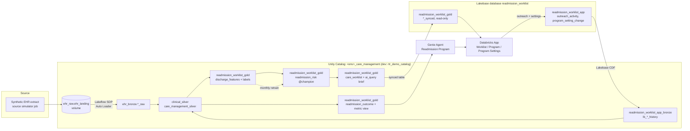

# Readmission Prevention Worklist

A reference solution on Databricks that helps a hospital care management team cut avoidable 30-day readmissions. Every morning it scores yesterday's discharges for readmission risk, routes high-risk patients to the right care manager with a plain-language outreach brief, captures each outreach call, and measures whether the program is actually moving readmission rates.

> **Status:** design phase. The high-level design is complete (see [`docs/`](docs/)); implementation is in progress. Sections marked *(planned)* describe the target state.
>
> All data is **synthetic**. No real patient or customer data is used anywhere in this repository.

## Business problem

Hospitals pay twice for avoidable readmissions: the cost of the return stay, and CMS Hospital Readmissions Reduction Program (HRRP) penalties on Medicare base payments. Care management teams know that a timely post-discharge call and a 7-day follow-up appointment reduce readmissions, but they cannot call everyone. They need a short, prioritized, explainable list every morning, and leadership needs to see whether the outreach is working.

| Stakeholder | What they get |
|---|---|
| VP of Care Management (executive sponsor) | Readmission rate, reach rate, 7-day follow-up rate, and estimated cost avoided, by facility and risk tier |
| Care Manager (daily user) | A prioritized worklist with the top risk drivers and an AI-drafted outreach brief per patient; one click to log the call |
| Data Platform / Architecture | One Declarative Automation Bundle, governed PHI, environment-local deployment, no hand-built infrastructure |

## Architecture

The solution is a single integrated loop. Each layer feeds the next, and outreach results flow back into the lakehouse to measure outcomes and retrain the model.



### Operating steps

| # | Step | Who / what | Key assets |
|---|---|---|---|
| 1 | Configure program | Care Management Leadership, in the app's Program Settings tab | Lakebase `readmission_worklist_app.program_setting_change`; seed files for the initial load |
| 2 | Ingest + curate | `<env>_readmit_daily_cycle` > `ingest_curate` (Lakeflow Spark Declarative Pipeline) | `ehr_raw.ehr_landing` to `ehr_bronze` to `clinical_silver` / `care_management_silver` to `readmission_worklist_gold.discharge_features` |
| 3 | Score + prioritize | `score_discharges` task | `readmission_worklist_gold.readmission_risk@champion`, `discharge_risk_score` |
| 4 | Build + publish worklist | `build_worklist` task | `ai_query` outreach brief, `readmission_worklist_gold.care_worklist`, Lakebase synced tables |
| 5 | Work the worklist | Care Manager, in the app's Worklist tab | Lakebase `readmission_worklist_gold.care_worklist_synced` (read), `readmission_worklist_app.outreach_activity` (insert) |
| 6 | Sync changes back | Lakebase CDF (change data feed) | `readmission_worklist_app_bronze.lb_*_history` |
| 7 | Measure + ask Genie | Leadership / Quality, in the app's Program tab | Genie Agent over `readmission_worklist_gold.readmission_outcome` and `readmission_program_metrics` |
| 8 | Retrain + repeat | `<env>_readmit_model_training` (monthly) | MLflow experiment, `@challenger` promoted to `@champion` only if it beats the current model |

The full operating pattern, deployment pattern, and entity-relationship diagram are in [`docs/readmission-worklist-high-level-design.pdf`](docs/readmission-worklist-high-level-design.pdf).

### Naming convention

| Layer | Pattern | This solution |
|---|---|---|
| Raw (files) | `<source_system>_raw` | `ehr_raw` (volume `ehr_landing`) |
| Bronze | `<source_system>_bronze` | `ehr_bronze`; `readmission_worklist_app_bronze` (the app is a source system; Lakebase CDF lands here) |
| Silver | `<data_domain>_silver` | `clinical_silver`, `care_management_silver` |
| Gold | `<data_product>_gold` | `readmission_worklist_gold` (tables, metric view, and the model) |
| Shared governance | `phi_governance` | Mask and row filter functions used by every product |
| Lakebase | project and database named after the app | project `readmission-worklist`, database `readmission_worklist` |
| Lakebase schemas | mirror UC at the schema level | `readmission_worklist_gold` (synced tables, `_synced` suffix); `readmission_worklist_app` (app-owned writes) |

Names line up at the **schema** level because that is where Lakebase maps them: a synced table's UC schema becomes its Postgres schema, and Lakebase CDF maps one Postgres schema to one UC schema. One database per app keeps the synced worklist and the app's writes joinable in Postgres. Lakebase resource IDs allow hyphens only, while Postgres and UC names use underscores.

### Governance

- Every PHI column carries a governed tag `phi = direct_identifier | quasi_identifier`.
- Tag-driven ABAC policies on the silver and gold schemas mask direct identifiers and filter rows by facility for every SQL, notebook, and Genie read.
- The `readmission_worklist_app_bronze` schema (Lakebase CDF destination) is excluded from masks and filters because CDF destinations must not carry them; access is restricted to the pipeline identity instead.
- Unity Catalog row filters do not apply inside Lakebase Postgres, so the app scopes every query to the signed-in user's facility assignments. Only the minimum columns a care manager needs are synced to Lakebase.
- The Program Settings tab is limited to the `care_mgmt_leadership` group; every change is an append-only row with who, when, and why.
- **Dev-only deviation:** `rtr_demo_catalog` grants `account users` SELECT catalog-wide, which inherits into the unmasked CDF landing schema. Accepted for dev because all data is synthetic; prod uses a dedicated catalog with no account-wide grants.

### Key design decisions and trade-offs

| Decision | Why | Trade-off |
|---|---|---|
| One daily job with ordered tasks | One schedule to run and explain | Less independent scheduling per stage |
| Batch scoring, no serving endpoint | Discharges are scored once a day | Not real-time at discharge |
| Worklist status derived from `outreach_activity` | Synced tables are read-only in Postgres | One join in the app query |
| Lakebase CDF for write-back | Native, about 15 s latency, no job to maintain | Public Preview; source tables need `REPLICA IDENTITY FULL` |
| Program Settings tab writes to Lakebase, applied by the pipeline | Leadership owns thresholds and capacity, with an audit trail, reusing the CDF pattern | Changes take effect on the next daily cycle |
| Separate Lakebase schemas, one database | Postgres cannot join across databases; the app joins the synced worklist with its own writes | Schema-level ownership must be managed carefully |
| XGBoost on LACE-style features | Clinicians recognize the drivers; explainable with SHAP | Not a deep clinical model; tuned for adoption |

## Prerequisites

| Requirement | Notes |
|---|---|
| Databricks workspace (AWS) | Unity Catalog, serverless compute, Databricks Apps, Genie, and Lakebase Postgres enabled |
| Lakebase Change Data Feed preview | A workspace admin enables "Lakebase Change Data Feed" on the Previews page |
| Unity Catalog catalog | Must **not** use default storage (a Lakebase CDF requirement). Dev uses `rtr_demo_catalog` |
| Databricks CLI | v0.294.0 or later (`databricks postgres` command group) |
| Python | 3.11+ with `databricks-sdk` 0.81.0 or later |
| Foundation Model endpoint | Any pay-per-token chat model; set through the `llm_endpoint` bundle variable |
| Permissions | CREATE CATALOG (or an existing catalog), CAN MANAGE on the Lakebase project, workspace admin for preview enablement |

## Deploy and run *(planned)*

```bash
# 1. Authenticate
databricks auth login --profile <profile>

# 2. Validate and deploy the bundle to dev
databricks bundle validate -t dev --profile <profile>
databricks bundle deploy   -t dev --profile <profile>

# 3. One-time setup: Lakebase synced tables, Lakebase CDF feed, Genie Agent (idempotent)
databricks bundle run readmit_setup -t dev --profile <profile>

# 4. Generate synthetic history and today's extract
databricks bundle run readmit_source_simulator -t dev --profile <profile>

# 5. Train the first model and set @champion
databricks bundle run readmit_model_training -t dev --profile <profile>

# 6. Run the daily cycle (ingest, score, build and publish worklist)
databricks bundle run readmit_daily_cycle -t dev --profile <profile>

# 7. Deploy the app
databricks bundle run readmission_worklist_app -t dev --profile <profile>
```

## Repository structure *(planned)*

```
readmission-risk-worklist/
├── databricks.yml              # Bundle definition, variables, dev/prod targets
├── resources/                  # Bundle resources: pipeline, jobs, app, schemas, volume
├── src/
│   ├── simulator/              # Synthetic EHR extract generator
│   ├── pipeline/               # Lakeflow SDP: bronze, silver, gold
│   ├── ml/                     # Training, champion/challenger promotion, batch scoring
│   ├── worklist/               # Worklist build, ai_query briefs, synced table refresh
│   ├── setup/                  # Lakebase synced table, CDF feed, Genie Agent, ABAC policies
│   └── app/                    # Databricks App (worklist + program tabs)
├── seeds/                      # facility, risk_tier_policy, care_team_assignment
├── evidence/                   # Committed run output: notebook outputs, logs, query results
└── docs/                       # High-level design (PDF and HTML source)
```

## Configuration *(planned)*

Bundle variables in `databricks.yml`:

| Variable | Purpose | Example |
|---|---|---|
| `env` | Environment name used in job names and guardrails | `dev`, `prod` |
| `catalog` | Unity Catalog catalog | `rtr_demo_catalog` (dev), `prod_care_management` (prod) |
| `lakebase_project` | Lakebase project ID | `readmission-worklist` |
| `lakebase_database` | Lakebase Postgres database | `readmission_worklist` |
| `llm_endpoint` | Foundation Model endpoint used by `ai_query` | your workspace's pay-per-token chat endpoint |
| `warehouse_id` | SQL warehouse for the app and Genie | lookup by name |
| `avg_readmission_cost` | Cost assumption used by the metric view for cost avoided | `15000` |

## Built with AI

This solution was designed and built with Claude Code as a pair programmer. Design decisions, trade-offs, and the value narrative are the author's own.
